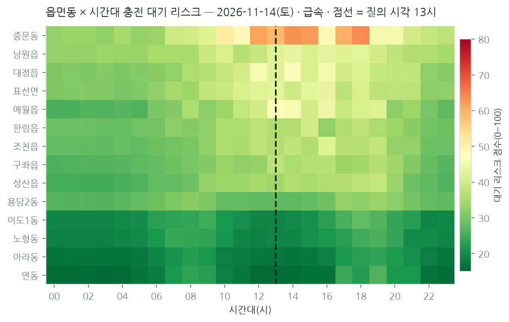
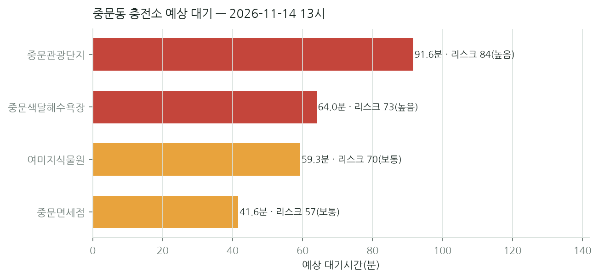
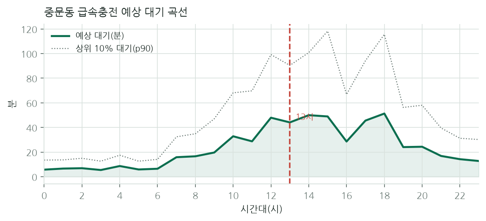
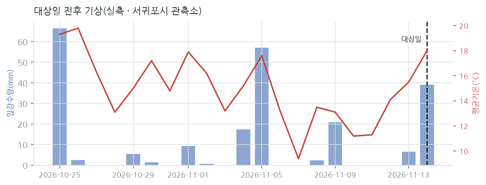
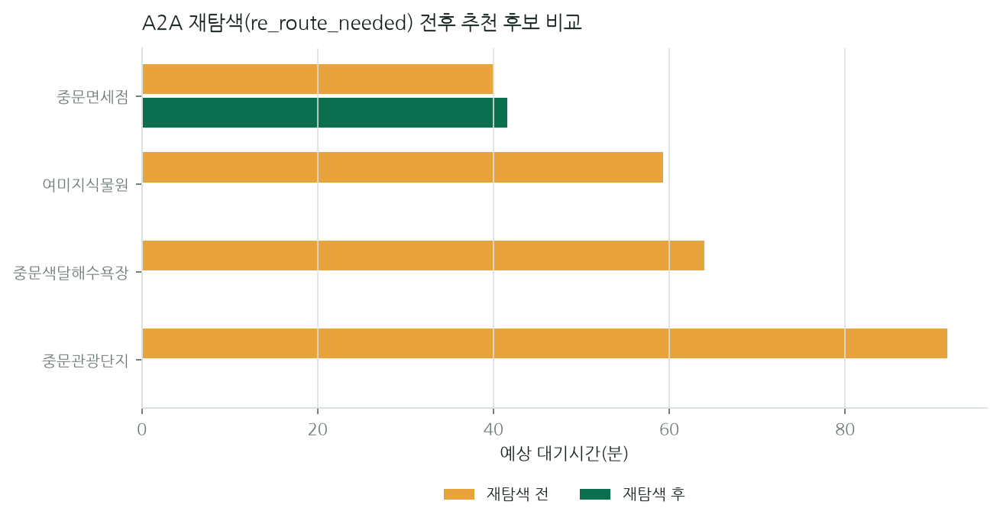
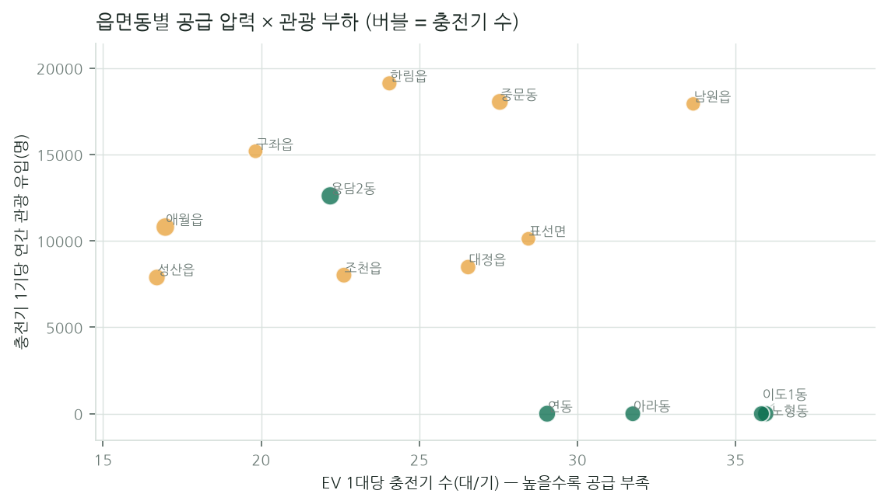

# JejuEV Guardian — 충전 대기·이동 리스크 리포트

- 생성: 2026-11-16 13:18 · 분석 엔진: `zerokey` · 신뢰도: 0.74
- 질의: “비 오는 주말에 서귀포 중문에서 안전하게 충전할 곳 찾아줘”
- 시나리오: 서귀포시 중문동 · 2026-11-14(토) 13시 · 급속

## 1. 한눈에 보는 결론
- 2026-11-14(토) 13시 중문동 기준, 가장 유리한 곳은 '중문면세점'(예상 대기 41.6분, 리스크 57/100)입니다.
- 같은 시각 중문동 평균 예상 대기는 44.1분이며, 상위 10%는 90.4분까지 늘어납니다.
- 피해야 할 시간대는 18:00-19:00(51분), 14:00-15:00(50분), 15:00-16:00(49분) 입니다.
- 기상·안전 검증에서 위험 충전소 3곳을 후보에서 제외하고 재탐색했습니다. 아래 추천은 재탐색 이후 결과입니다.
- 안전 기준을 통과한 후보가 1곳뿐이라, 부득이한 대안은 '주의' 표시와 함께 제시합니다.

## 2. 추천 충전소 TOP3

| 순위 | 충전소 | 충전기 | 예상 대기 | 상위10% | 리스크 | 주차 | 운영시간 |
|---:|---|---:|---:|---:|---:|---|---|
| 1 | 중문면세점 | 12기 | 41.6분 | 90.4분 | 57(보통) | 실내/유료 | 24시간 |
| 2 | 여미지식물원 | 10기 | 59.3분 | 94.4분 | 70(보통) | 야외/무료 | 24시간 |
| 3 | 중문색달해수욕장 | 8기 | 64.0분 | 104.3분 | 73(높음) | 야외/무료 | 09:00-18:00 |

## 3. 피해야 할 시간대

- **18:00-19:00** — 예상 대기 51.3분
- **14:00-15:00** — 예상 대기 50.0분
- **15:00-16:00** — 예상 대기 48.9분

## 4. 기상·안전

- 기상: 강수 39.0mm · 최대풍속 4.4m/s · 평균기온 18.0°C (내장 실측 기상(2024-01~현재), 서귀포시)
- 호우 경보 수준(39.0mm) — 해안도로·저지대 진입 주의

**재탐색(re_route_needed)으로 제외된 충전소**
- 여미지식물원 — 예상 대기 59.3분(과거 패턴 30.1분 × 공급계수 1.25 × 기상 1.25); 야외 충전기 · 강수/강풍 노출
- 중문색달해수욕장 — 예상 대기 64.0분(과거 패턴 30.1분 × 공급계수 1.25 × 기상 1.25); 야외 충전기 · 강수/강풍 노출
- 중문관광단지 — 예상 대기 91.6분(과거 패턴 30.1분 × 공급계수 1.25 × 기상 1.25); 야외 충전기 · 강수/강풍 노출; 점검중 상태(가용성 낮음)

## 5. 차트

## 6. A2A 핸드오프 로그

| 홉 | 시각 | 보낸 곳 → 받은 곳 | 의도 | 검증 | 상태 | 지연(ms) | 요약 |
|---:|---|---|---|---|---|---:|---|
| 1 | 13:18:20.654 | orchestrator → ev_demand_agent | charging_wait_risk | 통과 | ok | 170 | 중문동 2026-11-14(토) 13시 급속 기준 지역 평균 예상 대기 44.1분, 최적 후보 '중문면세점' |
| 2 | 13:18:20.666 | orchestrator → weather_safety_agent | safety_weather_check | 통과 | rework_request | 11 | 2026-11-14 서귀포시 기상: 강수 39.0mm·최대풍속 4.4m/s·평균 18.0°C → 후보 5곳  |
| 3 | 13:18:20.848 | weather_safety_agent → ev_demand_agent | re_route | 통과 | ok | 181 | 중문동 2026-11-14(토) 13시 급속 기준 지역 평균 예상 대기 44.1분, 최적 후보 '중문면세점' |
| 4 | 13:18:20.856 | orchestrator → weather_safety_agent | safety_weather_check | 통과 | ok | 7 | 2026-11-14 서귀포시 기상: 강수 39.0mm·최대풍속 4.4m/s·평균 18.0°C → 후보 5곳  |

## 7. 근거 데이터 (수집 시점 포함)

| 데이터 | 기준일 | 단위/입도 | 활용 |
|---|---|---|---|
| [140] 요일별 전기자동차 대기 시간 | 2022-10-31 | 읍면동×요일×시간×충전기유형 | 요일·시간대 대기 패턴 |
| [494] 전기자동차 충전소 정보 | 2025-09-18 | 충전소×충전기유형 | 충전소·충전기 현황 |
| [512] 제주특별자치도 전기자동차 보급 현황 | 2024-12-31 | 연×읍면동×차종 | EV 등록대수(공급 압력) |
| [745] 관광지별 내·외국인 유입자 수 | 2024-12-31 | 월×관광지 | 관광 유입(계절 계수) |
| [756] 일별 기상 정보 | 실시간(Open-Meteo 재분석) | 일×관측소 | 대상일 기상 |
| [493] 교통사고 다발지역 정보 | 2023-12-31 | 다발지역 | 사고다발지역 안전 검증 |

---
JejuEV Guardian · 제주데이터허브 Open API 기반 · 계산은 결정적 코드, 문장은 규칙/LLM 보조